# NovelWeaver for Android 2.3.0

An Android app with the current NovelWeaver editing interface and engine bundled
offline. The native Android host handles files, Android Keystore encryption,
text-to-speech and Open WebUI requests. It does not load the GitHub Pages website
to edit your writing and does not need a local web server.

## Bookcase

In **Read**, select **Bookcase** immediately to the right of **Edit chapter**.
Each series has its own lit wooden shelf. Books have 3D covers, spines and page
edges. Tap a book to pull it forward, then choose **Open book** to read it.
Use **Spines / Covers** to rotate the books, and swipe a shelf to browse.
Books without artwork receive a titled cover. Animations respect reduced-motion
preferences. The library works offline with no additional rendering download.

**Details** shows the selected book’s full back cover. Tap it to zoom and swipe
the enlarged image. A book without back artwork shows a clear empty state.
In **Manage covers**, add, replace or remove **Front cover**, **Spine image**,
and **Back cover** separately. Use a tall, narrow image for the spine. All three
images are saved in the project and preserved by JSON import and backup.
EPUB and DOCX export continue to include the front and back covers.

- **Import series** accepts multiple `.novel.json` projects, creating a shelf for each series.
- **Import books** accepts multiple EPUB, DOCX, TXT, or `.novel.json` files. Choose an existing shelf or name a new series.
- **Keep current series** copies the open project onto the bookcase.

Imported copies are stored on this device and remain available after restarting.
The source files are retained. Editing a bookcase book saves to its shelf;
use **Save as** for a separate project backup. EPUB imports include readable
text, chapter order, author and available front cover; page layouts and DRM are
not supported.

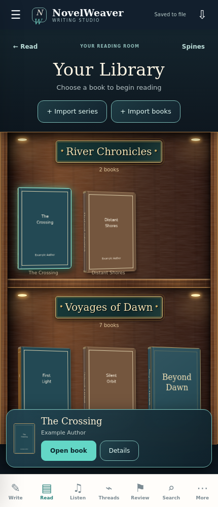
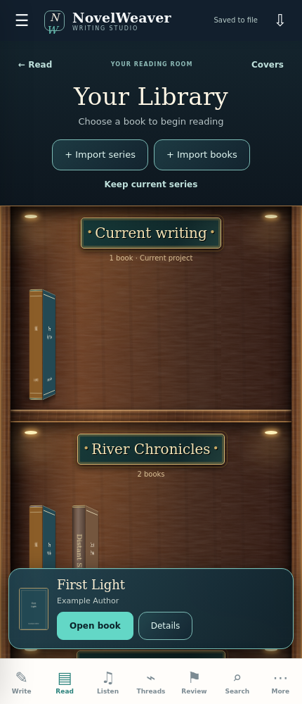
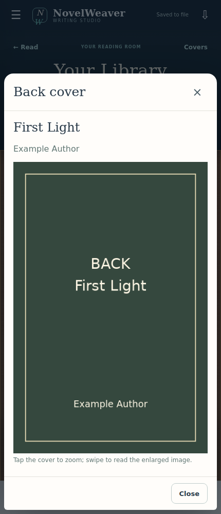

## Screenshots

The gallery covers the Android app’s main features. The Bookcase and Manage covers images show version 2.3.0; the other images are captures of the [2.1.3 bundled editor](https://github.com/chronos1981/novelweaver-android/pull/2), rendered at a phone-sized **430 × 1000** viewport with demonstration manuscripts, covers, and voice names. Native Android status bars and document-picker dialogs are not included. Click any image to open it at full size.

<table>
<tr><td align="center" valign="top"><a href="docs/screenshots/write.png">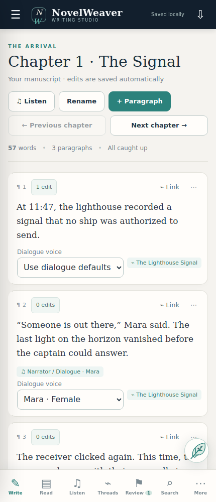</a><br><strong>Writing editor</strong><br><sub>Edit paragraphs, choose dialogue presets, and track edit counts.</sub></td><td align="center" valign="top"><a href="docs/screenshots/listen.png">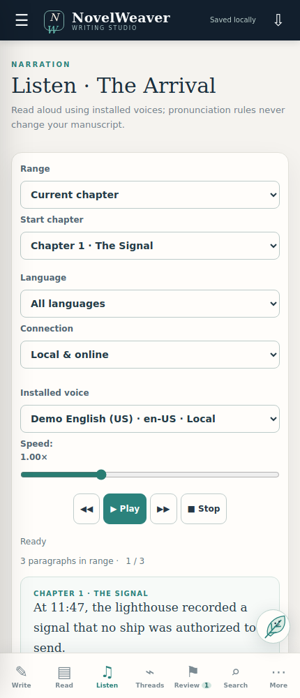</a><br><strong>Listen and voice filters</strong><br><sub>Choose chapter/book range, language, local or online voices, speed, and playback controls.</sub></td></tr>
</table>

<details>
<summary><strong>Writing and your library</strong> — 6 screenshots</summary>

<table>
<tr><td align="center" valign="top"><a href="docs/screenshots/library.png">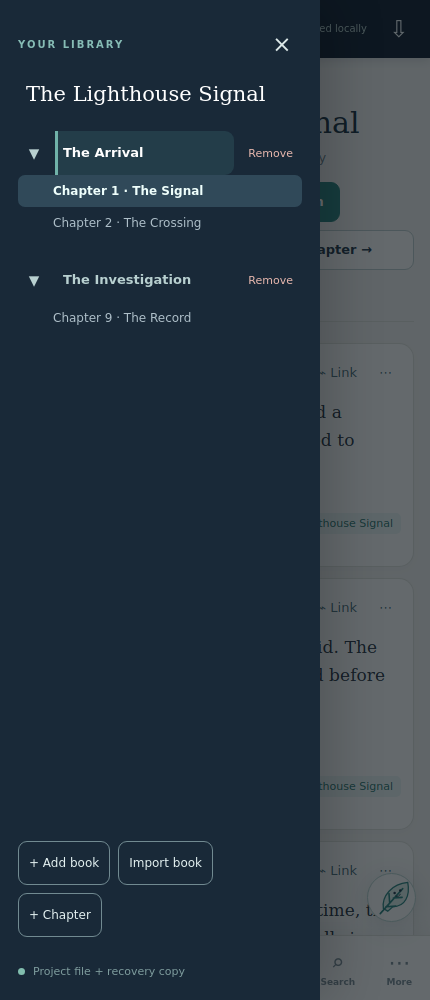</a><br><strong>Books and chapters</strong><br><sub>Organize a series, collapse chapter lists, and add or import books.</sub></td><td align="center" valign="top"><a href="docs/screenshots/write.png"></a><br><strong>Writing editor</strong><br><sub>Edit paragraphs, choose dialogue presets, and track edit counts.</sub></td></tr>
<tr><td align="center" valign="top"><a href="docs/screenshots/paragraph-actions.png">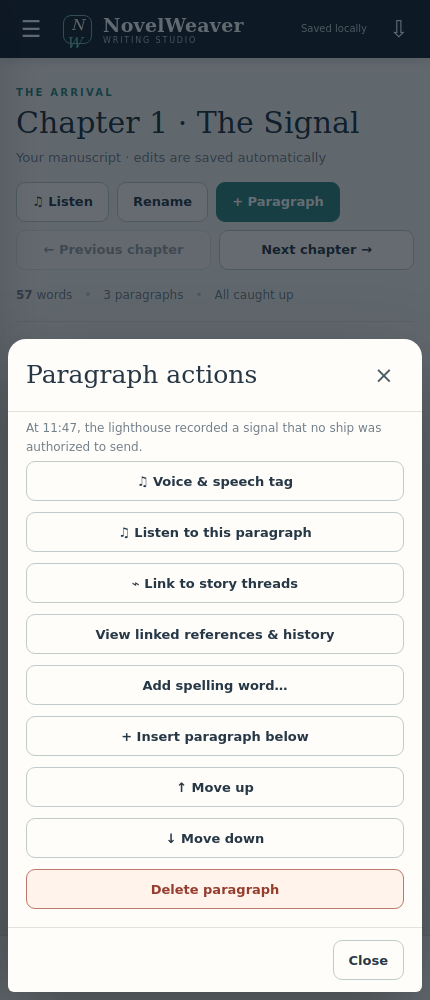</a><br><strong>Paragraph actions</strong><br><sub>Split, move, merge, link, listen to, and manage paragraphs.</sub></td><td align="center" valign="top"><a href="docs/screenshots/references-history.png">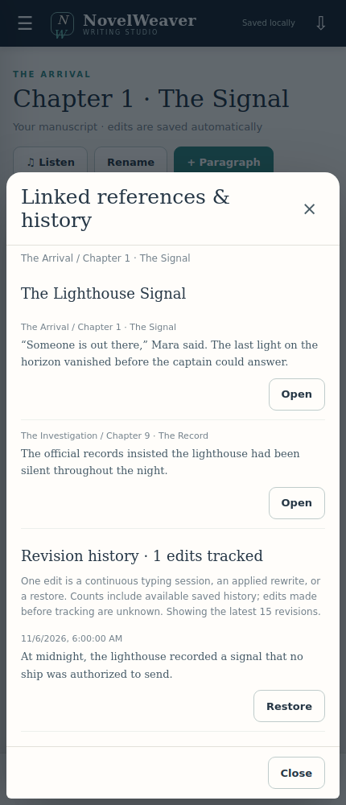</a><br><strong>References and revision history</strong><br><sub>Follow linked passages and review or restore earlier paragraph text.</sub></td></tr>
<tr><td align="center" valign="top"><a href="docs/screenshots/project-settings.png">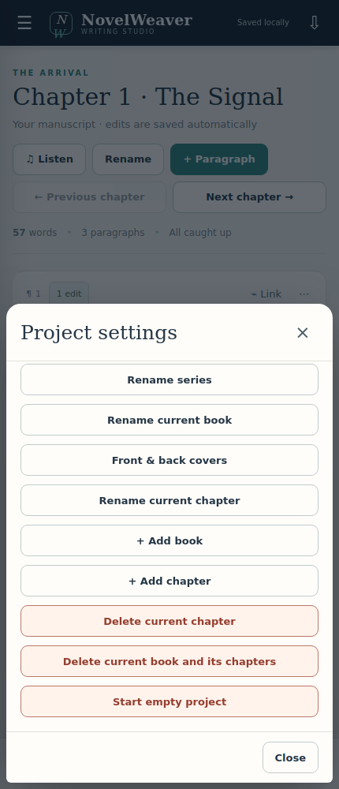</a><br><strong>Project structure</strong><br><sub>Rename your series, books, and chapters; manage the project.</sub></td><td align="center" valign="top"><a href="docs/screenshots/dictionary.png">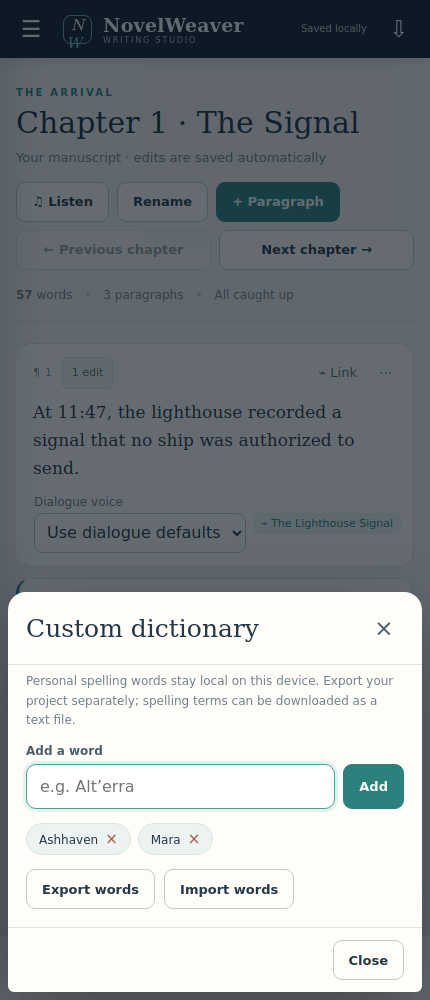</a><br><strong>Custom spelling dictionary</strong><br><sub>Add and manage names or terms that proofreading should accept.</sub></td></tr>
</table>

</details>

<details>
<summary><strong>Reading</strong> — 3 screenshots</summary>

<table>
<tr><td align="center" valign="top"><a href="docs/screenshots/read-plain.png">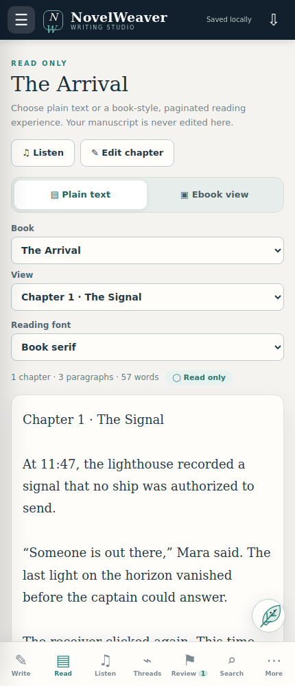</a><br><strong>Plain-text reader</strong><br><sub>Read a chapter or a whole book without editing the manuscript.</sub></td><td align="center" valign="top"><a href="docs/screenshots/read-ebook.png">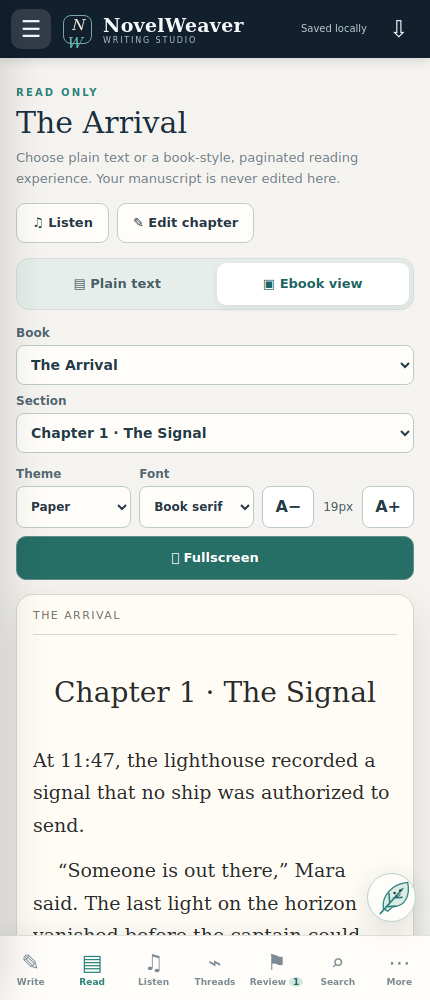</a><br><strong>Ebook layout</strong><br><sub>Choose paper, sepia, or night themes and reading fonts, including OpenDyslexic.</sub></td></tr>
<tr><td align="center" valign="top"><a href="docs/screenshots/read-fullscreen.png">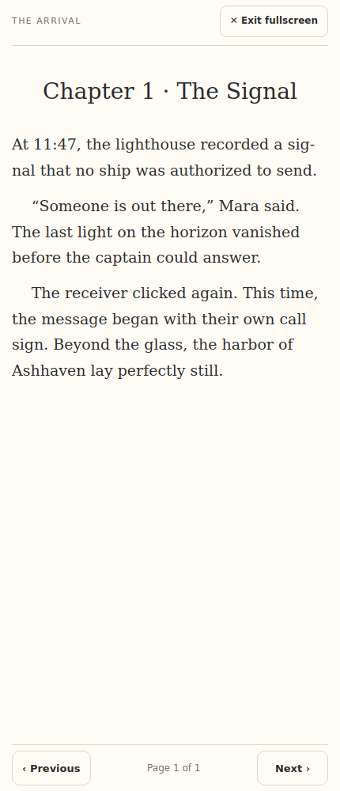</a><br><strong>Fullscreen reading</strong><br><sub>Use paginated book-style reading with page controls and saved reading position.</sub></td></tr>
</table>

</details>

<details>
<summary><strong>Narration and voice controls</strong> — 9 screenshots</summary>

<table>
<tr><td align="center" valign="top"><a href="docs/screenshots/listen.png"></a><br><strong>Listen and voice filters</strong><br><sub>Choose chapter/book range, language, local or online voices, speed, and playback controls.</sub></td><td align="center" valign="top"><a href="docs/screenshots/voice-presets.png">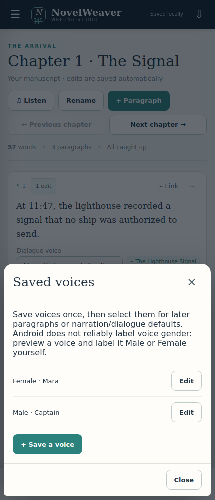</a><br><strong>Saved voices</strong><br><sub>Keep named male/female voice presets with the project.</sub></td></tr>
<tr><td align="center" valign="top"><a href="docs/screenshots/voice-preset-editor.png">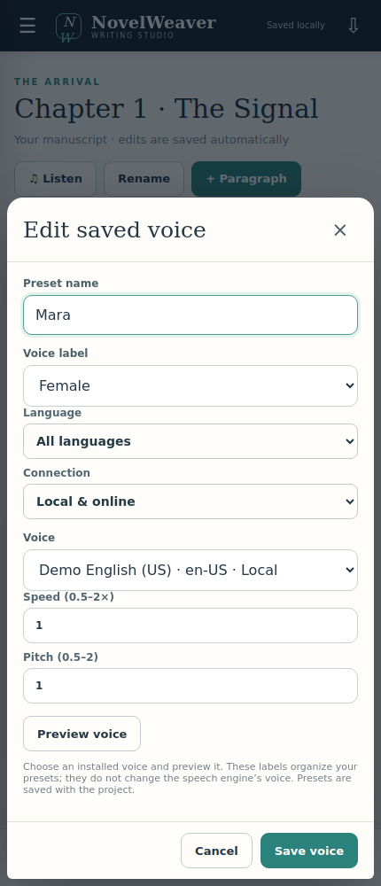</a><br><strong>Edit a voice preset</strong><br><sub>Select an installed voice, adjust speed and pitch, and preview the result.</sub></td><td align="center" valign="top"><a href="docs/screenshots/create-dialogue-voice.png">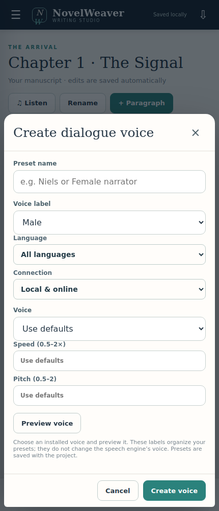</a><br><strong>Create a voice from a paragraph</strong><br><sub>Create a preset directly from the dialogue dropdown and apply it automatically.</sub></td></tr>
<tr><td align="center" valign="top"><a href="docs/screenshots/paragraph-voices.png">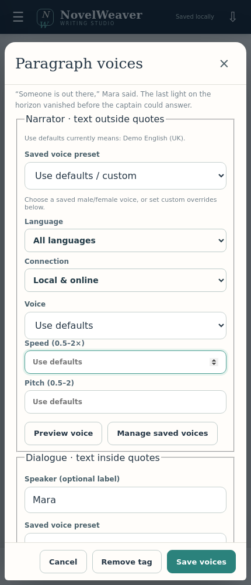</a><br><strong>Narrator settings per paragraph</strong><br><sub>Set the voice for text outside quotation marks.</sub></td><td align="center" valign="top"><a href="docs/screenshots/paragraph-dialogue.png">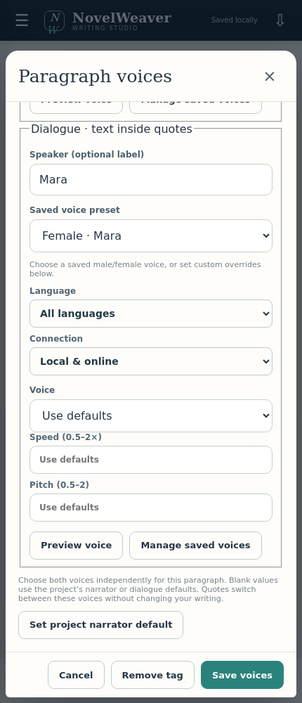</a><br><strong>Dialogue settings per paragraph</strong><br><sub>Assign a speaker and voice for quoted text while retaining narrator settings.</sub></td></tr>
<tr><td align="center" valign="top"><a href="docs/screenshots/narrator-defaults.png">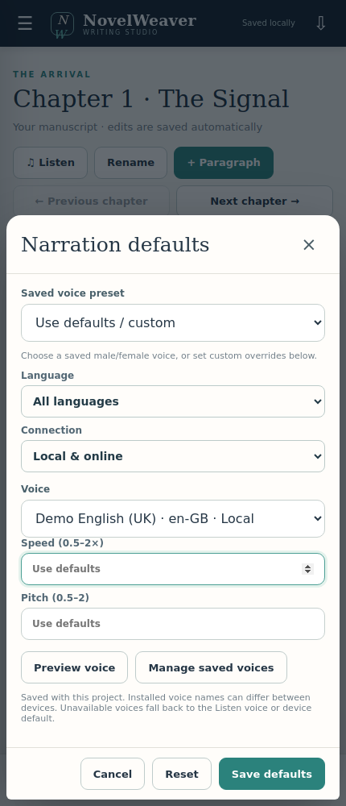</a><br><strong>Project narrator defaults</strong><br><sub>Set shared narration settings and reuse saved presets.</sub></td><td align="center" valign="top"><a href="docs/screenshots/dialogue-defaults.png">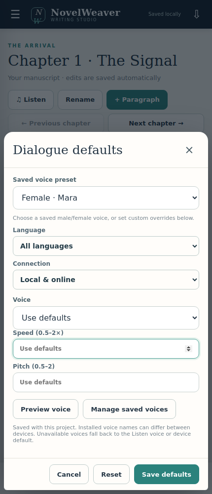</a><br><strong>Project dialogue defaults</strong><br><sub>Set shared dialogue settings independently of narration.</sub></td></tr>
<tr><td align="center" valign="top"><a href="docs/screenshots/pronunciations.png">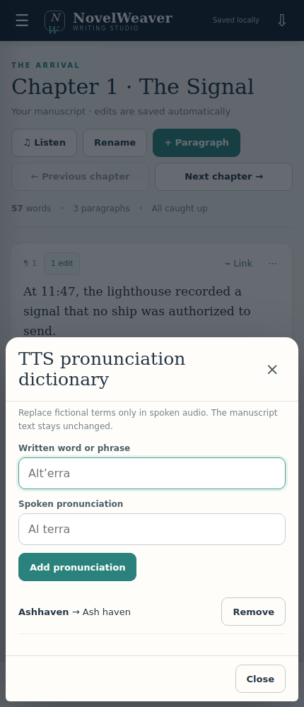</a><br><strong>Pronunciation dictionary</strong><br><sub>Change how fictional words are spoken without changing the manuscript.</sub></td></tr>
</table>

</details>

<details>
<summary><strong>Continuity, threads, and search</strong> — 4 screenshots</summary>

<table>
<tr><td align="center" valign="top"><a href="docs/screenshots/link-threads.png">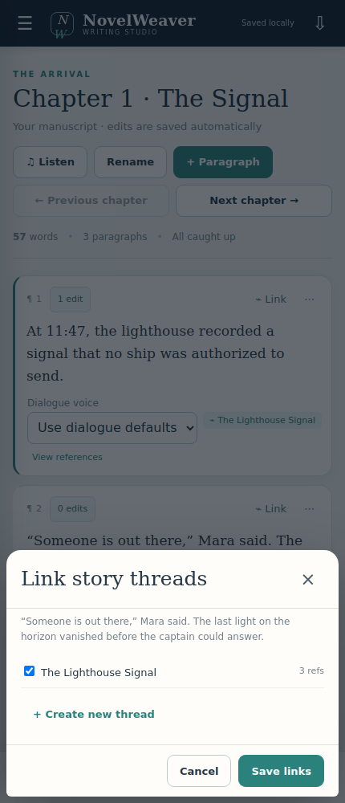</a><br><strong>Link paragraphs to threads</strong><br><sub>Connect a passage to a character, artifact, event, or other story thread.</sub></td><td align="center" valign="top"><a href="docs/screenshots/threads.png">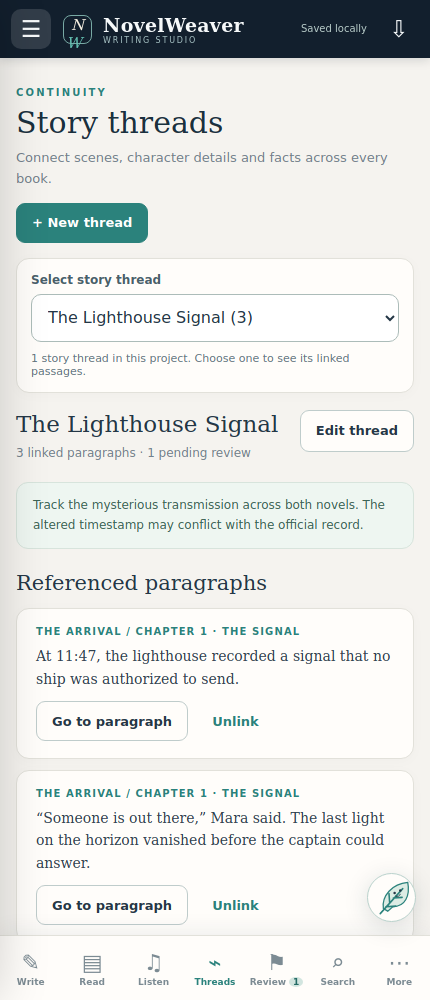</a><br><strong>Story thread overview</strong><br><sub>See notes and related passages across books.</sub></td></tr>
<tr><td align="center" valign="top"><a href="docs/screenshots/review-queue.png">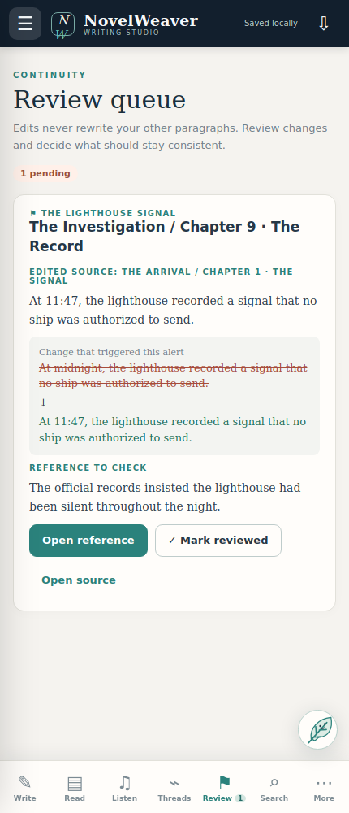</a><br><strong>Continuity review queue</strong><br><sub>Compare changed source passages with linked references before marking them reviewed.</sub></td><td align="center" valign="top"><a href="docs/screenshots/search.png">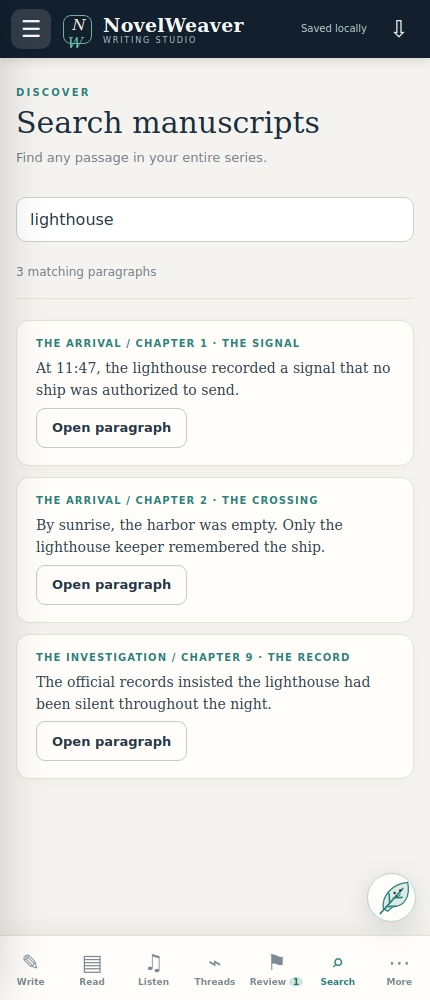</a><br><strong>Search across your series</strong><br><sub>Find matching passages in every book and jump to a paragraph.</sub></td></tr>
</table>

</details>

<details>
<summary><strong>Project files, covers, and exports</strong> — 5 screenshots</summary>

<table>
<tr><td align="center" valign="top"><a href="docs/screenshots/startup.png">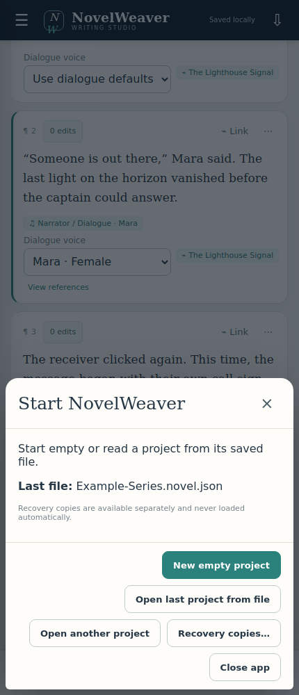</a><br><strong>Startup and recovery choices</strong><br><sub>Start empty, open the last actual file, choose another project, or inspect recovery copies.</sub></td><td align="center" valign="top"><a href="docs/screenshots/project-files.png">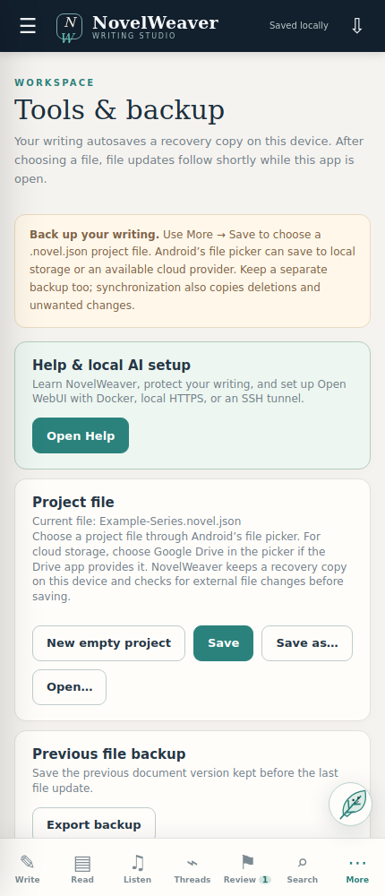</a><br><strong>Project files and backups</strong><br><sub>Open, save, Save as, and export a previous-file backup through Android document providers.</sub></td></tr>
<tr><td align="center" valign="top"><a href="docs/screenshots/import-export.png">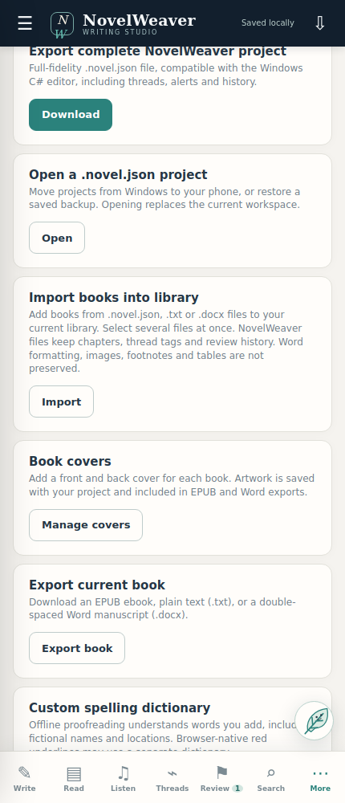</a><br><strong>Import and project export</strong><br><sub>Import books and export complete projects, including threads and history.</sub></td><td align="center" valign="top"><a href="docs/screenshots/book-covers.png">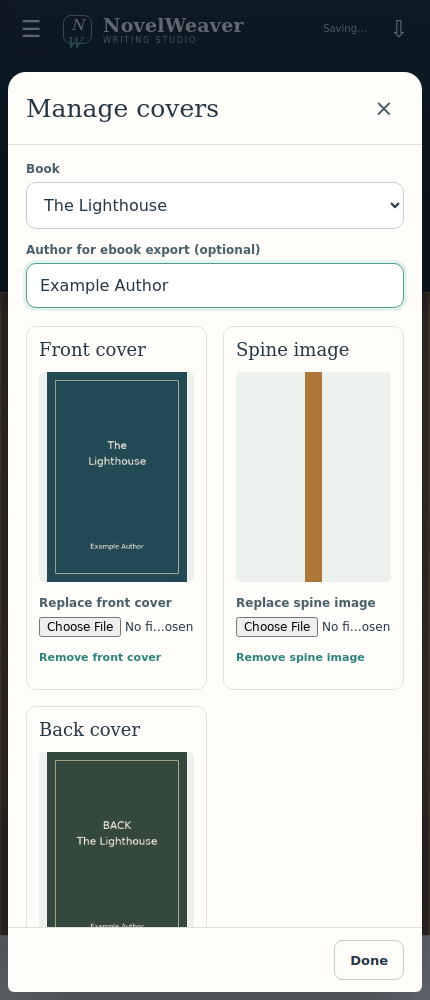</a><br><strong>Front, spine and back covers</strong><br><sub>Manage cover images and author metadata for reading and book exports.</sub></td></tr>
<tr><td align="center" valign="top"><a href="docs/screenshots/export-book.png">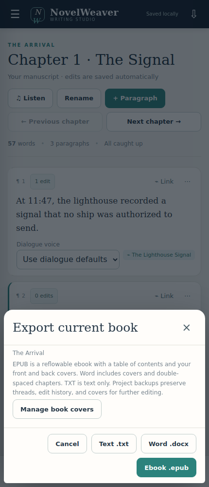</a><br><strong>Export the current book</strong><br><sub>Export plain text, Word DOCX, or EPUB ebooks with navigation and covers.</sub></td></tr>
</table>

</details>

<details>
<summary><strong>Quill assistant and help</strong> — 3 screenshots</summary>

<table>
<tr><td align="center" valign="top"><a href="docs/screenshots/quill.png">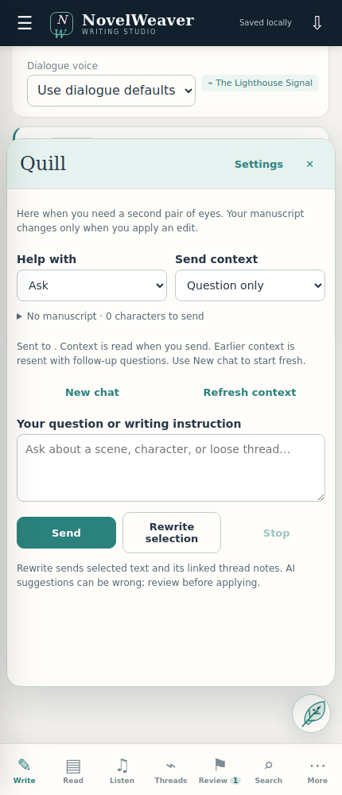</a><br><strong>Quill writing assistant</strong><br><sub>Ask questions or request rewrites using selected manuscript context.</sub></td><td align="center" valign="top"><a href="docs/screenshots/quill-settings.png">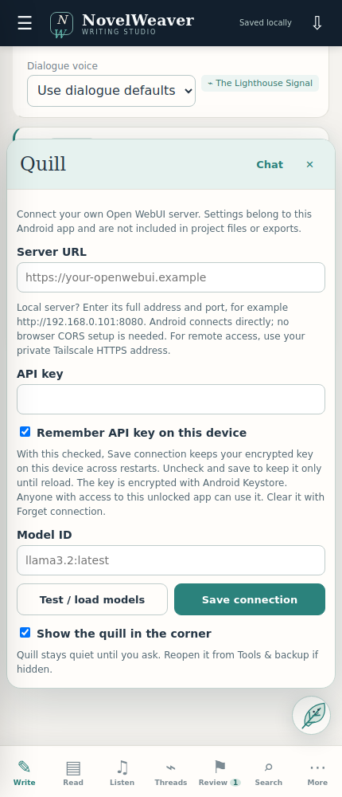</a><br><strong>Your Open WebUI connection</strong><br><sub>Configure your server, model, and key; no live service or secret is shown here.</sub></td></tr>
<tr><td align="center" valign="top"><a href="docs/screenshots/help.png">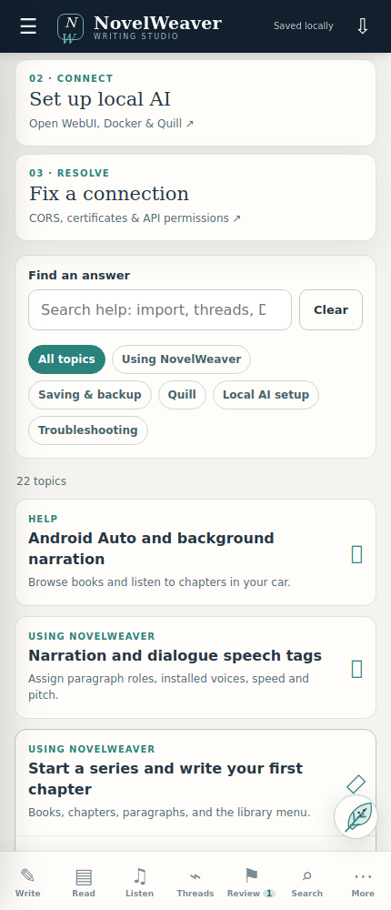</a><br><strong>Built-in help</strong><br><sub>Find writing, saving, narration, local AI, and troubleshooting guidance.</sub></td></tr>
</table>

</details>

<details>
<summary><strong>Android Auto layout illustrations</strong> — chapter browsing, playback, and Maps tile</summary>

**These two images are illustrative mockups, not screenshots from a vehicle or emulator.** Android Auto controls the actual layout, which varies with the car’s display and Android Auto version. They show the intended chapter browser, player, and compact media tile beside navigation.

[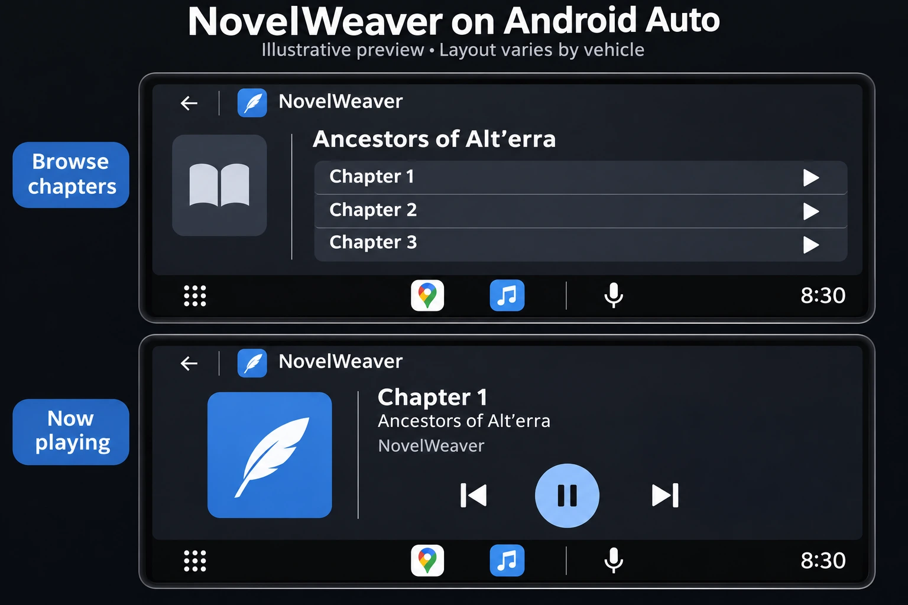](docs/screenshots/android-auto-illustration.webp)

[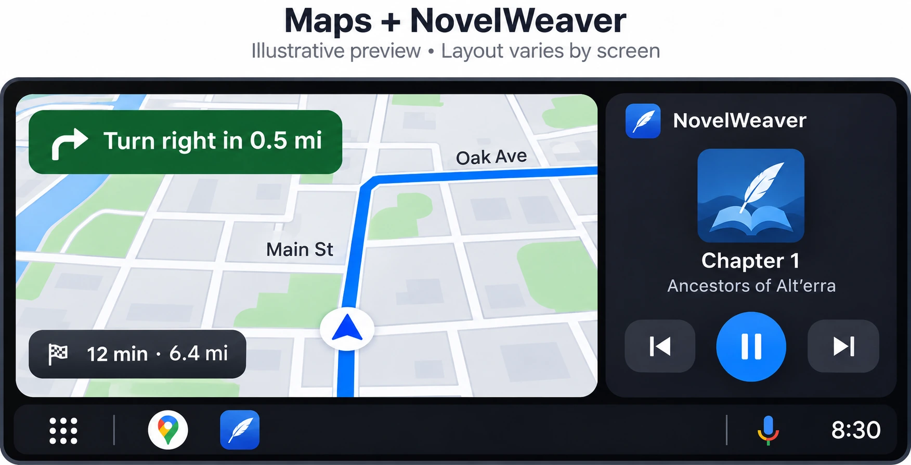](docs/screenshots/android-auto-maps-illustration.webp)

</details>

## Install and start

1. Download `NovelWeaver-Android.apk` to your phone and open it.
2. If Android asks, allow installation from the browser or file manager you used.
3. Open **NovelWeaver**. It needs Android 8.0 or newer and a current Android
   System WebView/Chrome. The app explains if its WebView needs updating.
4. On startup choose **New empty project**, **Open last project from file**, or
   **Open another project**. The last-project option reads the saved file again;
   it never automatically loads cached writing. If the file is unavailable,
   choose another file or start empty. Choose your `.novel.json` project.
   The system picker shows local files and the cloud providers available on
   your device. Google Drive can appear when its Android app is installed and
   signed in. Some devices/providers do not offer Drive for all operations.

This APK is a signed personal/development build, not a Play Store release. If
you installed an older build with a different signing certificate, Android may
refuse to update it. Export any unsaved writing in the old app before removing
that old installation. Saved document-provider project files are separate from
the private recovery data removed during uninstall.

Unsaved writing from earlier sessions is available separately under startup
**Recovery copies…**. Opening a recovery copy creates an unlinked workspace; use
Save as to choose its file. Starting empty keeps the last-file shortcut and
meaningful recovery copies, but does not load either automatically.

## Android Auto and background narration

1. Open the project on your phone and **Save** it to a `.novel.json` file before driving.
2. For this directly installed APK, open **Android Auto settings** on the phone.
   Tap **Version** to expand the version details, then tap that information ten
   times and accept developer mode. In the three-dot menu open **Developer
   settings → Unknown sources**. This is Android Auto's media-app testing option,
   separate from Android's permission to install APKs.
3. Reconnect Android Auto. Check **Customize launcher** if NovelWeaver is hidden.
4. Open **NovelWeaver → book → chapter** on the car display. Play/pause and
   previous/next chapter also work from supported steering-wheel controls.

Phone Listen playback now runs in the same native media service. It continues
with the screen off or editor closed. The playback notification and lock screen
provide media controls. Android Auto uses a listening interface; editing and file
selection stay on the phone. Select a chapter before narration starts: connecting
the car never starts speech by itself.

Saved narration/dialogue presets, speed, pitch, quote boundaries, imported voice
defaults, and pronunciation substitutions work in the background. Missing tagged
voices fall back to an installed Listen voice or the device default. Android TTS
engines determine voice availability; online voices still require a connection.
The car's previous/next controls navigate chapters; the phone Listen controls
continue to navigate paragraphs.

While the editor is open, the car sees its current project. When the service
starts without the editor, it reads the last selected project from the actual
file, not cached recovery writing. Keep cloud files accessible/offline or save a
local copy. A missing, slow, or inaccessible file asks you to reopen it on the
phone while parked; it never silently substitutes an older cached manuscript.

Pause/resume keeps the spoken position while the service lives, where the TTS
engine supplies word ranges. After a service/process restart, playback resumes
from the last paragraph. Audio interruptions pause narration; temporary focus
loss can resume automatically when focus returns. Disconnecting headphones pauses
without automatically restarting. Paused playback releases its wake lock and
removes its foreground notification after five minutes of inactivity.

This build adds Android Auto media support for personal testing. It has not been
verified in a physical car or certified for Google Play distribution.

## Save files and use Drive

To start fresh, choose **More → Project file → New empty project**. An existing
project with a chosen file is saved before switching; an unsaved workspace offers
Save, Discard workspace, or Cancel. The new project starts with a blank chapter
and paragraph and does not overwrite the previous project's file. Choose Save
to give it its own filename.

Use **More → Project file → Save** to choose the first project filename, or
**Save as** for a separate copy. Select Drive in Android's file picker when it
is available. No Google OAuth client ID or in-app Google sign-in is required.
If Drive isn't offered as a writable provider, save to Documents and use the
Drive app to upload/share the project file.

Edits get an app-private recovery copy after a short typing pause. Once a file
is chosen, updates to that document are scheduled about three seconds after
the recovery save. Cloud operations run separately so typing and recovery do
not wait on a slow cloud provider. Watch the header status:

- **On device · Save**: only this device's recovery copy exists.
- **File save pending**: recovery is safe; the document write is pending.
- **Saved to file**: the provider accepted the current file write. It may still
  have its own cloud upload to complete.
- **Choose version**: another visible document version was found;
  automatic document updates are paused while private recovery continues.
- **File save failed**: recovery remains local; retry Save or use Save as.

When an external version appears, choose this device's writing, the file, a
separate copy, or decide later. The decision is not repeated on every autosave;
a further external change can require another choice. Opening a project checks
its content before replacing the current workspace. The previous document
version is retained privately before writing; export it under
**More → Previous file backup**.

Android's Storage Access Framework cannot promise atomic replacement of a cloud
document. A provider failure or interrupted upload can leave its file incomplete.
Private recovery and the previous-file backup reduce this risk; keep independent
backups too. Avoid simultaneous editing on different devices and let the cloud
provider finish syncing before switching. NovelWeaver sees only the contents
the provider has made available, not edits still offline on another device.

Opening or saving grants access only to the document you choose. Android may
require choosing it again if the file moves, its permission expires, or its
provider changes. The app requires no broad storage permission.

The Windows app, web app and Android app share `.novel.json` data. Covers,
threads, alerts, edit counts and revision history travel with that file. Web
browser storage itself is not automatically imported; open a project file
exported/saved by that edition.

## Voice filters

Every installed-voice selector offers **Language** (for example en-US or en-GB)
and **Connection** filters: Local (offline), Online (network), both, or Unknown.
They are available in Listen, paragraph narrator/dialogue settings, saved voice
editors, and project defaults. Filters are remembered on this device and shared
between selectors. They do not change saved voice settings or playback. An
existing selection outside the filters remains visible with a note. Missing
voices and empty result lists are labelled explicitly. Connection type comes
from the speech engine’s metadata; unknown metadata is never guessed.

## Quick paragraph voice picker

Each paragraph card has a **Dialogue voice** combo box at its lower right.
Choosing a saved preset immediately updates and saves that paragraph’s quoted
dialogue voice; no Apply button is needed. Its narrator, manuscript and text edit history are preserved.
**Use dialogue defaults** removes the dialogue override. Existing custom settings
stay selected until you choose another option; an unavailable preset is never silently
replaced. If no presets exist, **Save a voice…** opens the voice manager.
The full paragraph voice dialog remains available through its speech badge or
**⋯ → Voice & speech tag**. The quick picker preserves reading/scroll position.

## Saved voices and dialogue playback

Open **Listen → Narration, dialogue & saved voices → Saved male/female voices**.
Choose **Save a voice**, give it a name (for example Niels or Torill), label it
Male or Female, choose an installed voice and optionally set speed/pitch.
**Preview voice** lets you audition it before saving. Android does not reliably
supply voice gender, so labels are user-assigned. Presets persist in the project.

On any paragraph, open **⋯ → Voice & speech tag**. The **Paragraph voices**
dialog has independent **Narrator · text outside quotes** and **Dialogue · text
inside quotes** controls. Set either or both to a named preset or installed
voice, with separate speed and pitch. Tap **Save voices**. Blank values use
the matching defaults. Use **Set project narrator default** in that dialog to
change the shared narrator. Presets are available for later paragraphs too. Editing a preset updates all paragraphs that refer
to it. Custom voice, speed and pitch values override a chosen preset; choosing
a preset clears those custom overrides. You can also use presets for shared
narration and dialogue defaults under Listen. A speaker name is an optional
label; a saved preset supplies the voice settings.

Matched straight or curly quotation marks use the dialogue voice. Text outside
quotes uses the narrator, including speech attributions in the same paragraph.
For example, `Niels said, “We should go,” then stood up.` uses the narrator,
then Niels's dialogue preset, then the narrator again. Apostrophes in contractions
are not dialogue boundaries. Unmatched quotation marks stay with the narrator;
add matching quotation marks within a paragraph for dialogue playback. A paragraph
can select one dialogue preset; split it to use different speakers' presets.

Blank settings inherit role defaults, then the Listen voice and speed, with
normal pitch (1). Tags and presets travel with `.novel.json`; imported books
freeze their original role settings on imported paragraphs. Missing installed
voices fall back with a warning. Split paragraphs inherit tags; merging requires
matching tags. The manuscript, edit history and TXT/DOCX/EPUB text are unchanged.
Voice quality, gender presentation, speed and pitch depend on the installed
speech engine. Older app editions may discard this metadata when saving.

## Features

- **Previous chapter / Next chapter** buttons in the Write header and at the
  bottom of each chapter switch between
  chapters in the current book. The first/last chapter disables the unavailable
  direction. Edits are committed before switching, and the new chapter opens at
  the top without automatically opening the keyboard.
- Books, collapsible chapters, paragraph editing, splitting, merging, moving
  and deleting; import multiple NovelWeaver JSON, TXT or DOCX books.
- Linked threads and notes, review alerts, full reference/history text,
  paragraph edit counts and revision restoration.
- Plain and paginated ebook reading, cover images, themes, font controls,
  OpenDyslexic font, reading position, swiping and fullscreen.
- Listen with Android TTS voices, chapter/book scope, speed and pronunciation
  rules. Install an offline voice in Android's speech settings for offline use.
  Online voices are labelled. Narration pauses when the app leaves the foreground.
  Resume uses the last reported word boundary when the engine supports it;
  otherwise it can restart the paragraph. No background narration service is used.
- Front/back covers and author metadata; EPUB, TXT and DOCX exports using the
  system Save picker. DOCX import retains text rather than Word page layout,
  cover artwork, tables, images or footnotes.
- Search, offline spelling lexicon, custom dictionary, searchable Help and Quill.
- Quill model loading, explicit context preview, follow-up chat, review and
  continuity modes, guarded selection rewrites, discard/apply/undo, and hidden
  `<think>` blocks. There is no automatic model-response timeout; Stop cancels.

Large documents and cover images consume more phone memory. Project input is
limited to 60 MB, exports to 64 MB, and model responses to 8 MB. Quill retains
the web edition's context and conversation size limits.

## Connect Quill to Open WebUI

Open Quill's **Settings**. Enter your server URL including its port where needed,
your API key, and model ID. Test/load models and save the connection.

Use your existing Tailscale HTTPS URL while away from home; the phone must be
connected to the appropriate Tailscale network. On your LAN, an address such as
`http://192.168.0.101:8080` works. Browser CORS and mixed-content configuration
do not apply to the native request transport. HTTP is restricted to local/private
network hosts; use HTTPS for public/remote servers. API keys and model access
must still be allowed by your Open WebUI account. Permit `/api/models` and
`/api/chat/completions` if your server restricts endpoints.

HTTPS certificate checks stay enabled. System and user-installed Android CA
certificates are trusted; a Caddy private CA trusted only on your Windows PC is
not automatically trusted on your phone. Your Tailscale HTTPS certificate can
avoid that separate private-CA setup. Proxies and your model server can impose
their own time limits even though this app has no inference timeout.

**Remember API key** encrypts it with an Android Keystore AES-GCM key in this
app's private data. It is not stored in WebView localStorage, project files or
exports. **Forget connection** deletes the saved encrypted value. Anyone with
access to this unlocked app can use it. The key and chat are not sent to a
NovelWeaver service. Your selected manuscript context is sent to your Open WebUI
server only when you press Send or Rewrite. Server/provider logs remain theirs.

## Build from source

Open this folder in Android Studio, select JDK 17 and install Android SDK 35.
The Gradle wrapper is included. From this folder run:

```sh
./gradlew testDebugUnitTest assembleDebug lintDebug
```

On Windows use `gradlew.bat`. The APK is
`app/build/outputs/apk/debug/app-debug.apk`. Gradle downloads required AndroidX
and build dependencies from Google and Maven Central. No API keys, OAuth client
IDs or manuscript content need to be added to source.

The personal signing key is deliberately excluded from this repository. Fresh
clones use Android's standard debug signing identity. Such builds cannot update
the supplied personal APK in place. To keep the same identity for your own
updates, restore your existing private key locally at
`signing/novelweaver-development.keystore`; that folder is ignored by Git.
Do not commit signing keys or API credentials.

`tools/package-web.py <path-to-web-index.html>` regenerates bundled web assets
from the upstream single-file editor. Its base adapter and Android integration
must be reviewed when upstream changes. Android-only secrets and file operations
remain in the native Java host. For shared JavaScript checks, with Node installed:

```sh
node tests/quick-voices.test.cjs
node tests/voice-filters.test.cjs
node tests/speech-tags.test.cjs
node tests/startup.test.cjs
node tests/android-adapter.test.cjs
node tests/bridge.test.cjs
node tests/chapter-navigation.test.cjs
node tests/paragraph-edits.test.cjs
node tests/book-export.test.cjs
```

See VALIDATION.md for completed checks and remaining device checks.
